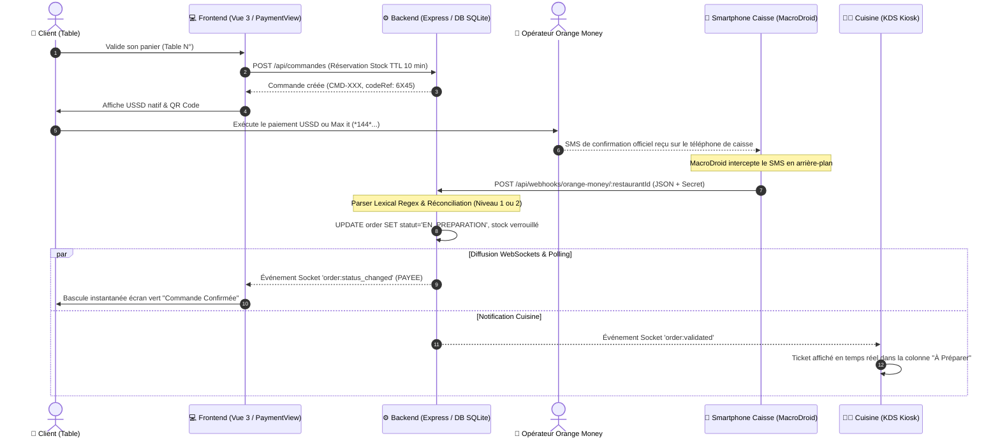
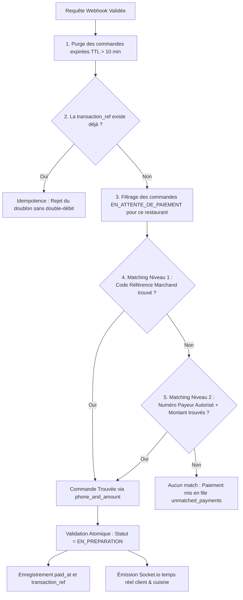
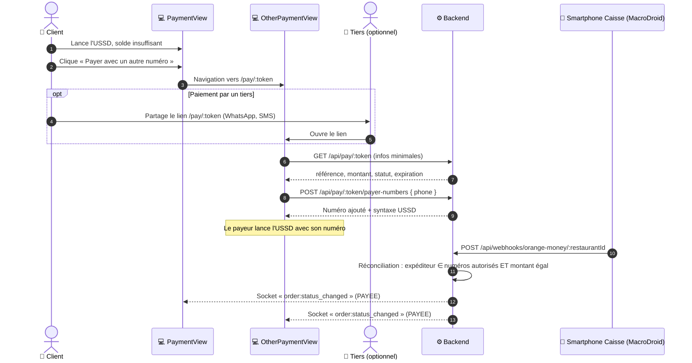

# ⚡ Système de Validation Automatique des Paiements (No-Aggregator)

> **Projet :** RestoPremium / SaasResto  
> **Module :** Réconciliation des paiements Mobile Money (Orange Money BF) via MacroDroid Bridge  
> **Statut :** Production & CI/CD validé (39/39 tests unitaires et d'intégration)

---

## 1. Vue d'Ensemble & Proposition de Valeur

Dans le secteur de la restauration en Afrique de l'Ouest, l'intégration des passerelles de paiement bancaires ou d'agrégateurs tiers classiques présente plusieurs freins majeurs :
1. **Commissions élevées :** Des prélèvements de 2% à 5% sur chaque transaction réduisent fortement la marge des restaurateurs.
2. **Délais de virement :** Les fonds sont bloqués sur des comptes séquestres 24h à 72h avant d'être reversés.
3. **Complexité contractuelle :** Nécessité de formalités administratives lourdes pour chaque établissement.

### L'approche "No-Aggregator" de RestoPremium
RestoPremium résout ce problème en établissant un **pont direct (bridge) sans intermédiaire** entre le paiement du client via son application/USSD Orange Money et le système de commande du restaurant :
* **Paiement direct :** L'argent va directement sur le compte Orange Money du restaurateur (Marchand ou Particulier/Caissier).
* **0% de commission tiers :** Seuls les frais opérateurs natifs s'appliquent.
* **Validation instantanée en < 2 secondes :** Un smartphone Android connecté en caisse écoute les notifications/SMS officiels de réception de fonds et notifie l'API de RestoPremium via un Webhook chiffré.
* **Notification temps réel :** Dès validation, le client voit son écran basculer sur la confirmation et le ticket s'imprime ou s'affiche immédiatement sur l'écran KDS de la cuisine.

---

## 2. Architecture Globale & Diagramme de Flux



---

## 3. Déclenchement Côté Client (Modes Marchand vs Classique)

Le système gère de manière transparente et multi-tenant deux types de comptes de restauration configurés dans la base de données :

| Critère | Compte Marchand Officiel | Compte Classique (Numéro Personnel / P2P) |
| :--- | :--- | :--- |
| **Profil restaurant** | Établissements avec numéro marchand agréé | Petits maquis, kiosques ou restaurants sans agrément |
| **Syntaxe USSD générée** | `*144*4*6*codeMarchand*montant*codeReference#` | `*144*2*1*numeroOM*montant#` |
| **Saisie requise du client** | Aucune saisie (code référence intégré dans l'USSD) | Obligation de renseigner son numéro de téléphone avant paiement |
| **Stratégie de matching** | Déterministe via le `codeReference` unique | Heuristique via le couple `(numeroClient + montant)` |

### Gestion des Navigateurs In-App (WebViews Réseaux Sociaux)
Lorsque le client scanne le QR Code de table depuis Facebook, TikTok, Instagram ou Snapchat, les navigateurs intégrés bloquent souvent le protocole `tel:`. Le composant [`PaymentView.vue`](file:///c:/Users/Dell/SAAS/SaasResto/src/views/client/PaymentView.vue) intègre :
1. **Solution Native (Navigateurs standards) :** Redirection automatique vers l'application téléphone native.
2. **Solution Android Deep-Link (Chrome Intent) :** `intent://...#Intent;scheme=https;package=com.android.chrome;end` pour sortir de la WebView.
3. **Solution Guide Visuel Assisté :** Copie en 1 clic de la syntaxe USSD avec bouton pour coller dans le clavier téléphonique.

---

## 4. Passerelle Mobile MacroDroid (Smartphone de Caisse)

Le téléphone de caisse (qui détient la puce SIM Orange Money ou l'application Max it) fait office de passerelle matérielle. L'application **MacroDroid** (gratuite sur le Play Store) y est installée.

### A. Déclencheur (Trigger)
* **Événement :** `Messages` ➔ `SMS Reçu`
* **Expéditeur :** Filtrer sur `OrangeMoney` ou `144` (ou tous les numéros en phase de test)
* **Contenu du message :** N'importe quel contenu (ou contenant `reçu` / `recu`)

### B. Action (Requête HTTP POST)
* **Méthode :** `POST`
* **URL de destination :**
  * *En production :*  
    `https://leci-production.up.railway.app/api/webhooks/orange-money`
  * *En réseau local direct (Wi-Fi de l'établissement) :*  
    `http://192.168.1.50:3000/api/webhooks/orange-money/resto-premium-01`
* **En-têtes HTTP (Headers) :**
  ```http
  Content-Type: application/json
  x-webhook-secret: resto_secret_2026
  ```
* **Corps de la requête (Body) :**
  ```json
  {
    "message": "[sms_message]",
    "sender": "[sms_number]"
  }
  ```
  *(Important : dans MacroDroid, la variable du texte du SMS est `[sms_message]` — ou `{sms_message}` selon la version — et NON `[sms_body]`. Utilisez le bouton `...` dans MacroDroid ➔ **Texte du SMS entrant** pour insérer la balise exacte).*

> [!IMPORTANT]
> **Configuration Dev Tunnels VS Code (si utilisé en développement local) :**
> Si vous exposez le port 3000 avec VS Code Dev Tunnels, faites un clic droit sur le port `3000` dans l'onglet **Ports** de VS Code et changez la visibilité de **Private** à **Public**. Faute de quoi, les requêtes du smartphone recevront un code d'erreur `401 Unauthorized` ou une redirection HTML.

---

## 5. Traitement Backend & Parser Lexical (`api/server.js`)

À la réception du webhook, le serveur applique une série de vérifications de sécurité et de normalisation textuelle :

### 1. Tolérance aux erreurs de syntaxe JSON Mobile
Les applications mobiles ou passerelles SMS omettent parfois d'échapper les sauts de ligne ou utilisent des guillemets simples. Un middleware sur-mesure capture l'erreur de parsing standard d'Express et reconstruit automatiquement un payload sain ou convertit le message brut.

### 2. Contrôle d'Accès Anti-Fraude
Le secret transmis dans l'en-tête `x-webhook-secret` (ou paramètre `?secret=`) est validé par rapport à la variable d'environnement `WEBHOOK_SECRET` (`resto_secret_2026`). Si absent ou erroné, la requête est immédiatement rejetée avec une erreur `401`.

### 3. Extraction Lexicale par Expressions Régulières (`parsePaymentNotification`)
Le message SMS brut est scanné pour en extraire les informations cardinales :
* **Montant :** Détection via regex des mentions `FCFA`, `F CFA`, `XOF` ou `F`.
* **Numéro Client :** Extraction des numéros de téléphone à 8 chiffres (commençant par 0, 5, 6, 7 avec ou sans indicatif `+226`).
* **Référence de Transaction :** Capture des libellés `Trans ID:`, `Réf Trans:`, `TxId:` pour le contrôle d'unicité.
* **Code Référence :** Détection des codes courts (ex: `ref 6X45`).

---

## 6. Moteur de Réconciliation en Base de Données (`api/db.js`)

La fonction `reconcilePaymentWebhook` applique une cascade d'arbitrage stricte :



### Règles de Réconciliation en Détail :
1. **Contrôle d'Idempotence :** Si un SMS est réémis (réseau mobile instable), le serveur vérifie la colonne `transaction_ref`. Si elle existe déjà, la commande n'est pas retraitée et une réponse neutre est renvoyée.
2. **Matching Strict (Niveau 3 supprimé) :** Sans code référence marchand explicite, une commande n'est validée automatiquement **que** si le numéro expéditeur du SMS appartient à la liste des numéros de transfert déclarés pour cette commande (`order_payer_numbers` / `payer_phone`) **ET** que le montant correspond exactement au `montant_total`. Tout paiement issu d'un numéro non déclaré est placé dans `unmatched_payments` (avec rattrapage automatique sur 30 minutes si le client ajoute ce numéro via `OtherPaymentView`).
3. **Fenêtre de Verrouillage Stricte (TTL 10 min) :** Seules les commandes créées il y a moins de 10 minutes sont éligibles. Cela évite d'attribuer un paiement reçu par hasard à une vieille commande abandonnée la veille.

---

## 7. Règle Métier Caisse & Cuisine (KDS)

Pour garantir une exploitation fluide et zéro confusion en salle :
* **Apparition après saisie du nom et numéro de transfert :** Lorsqu'un client valide simplement son panier (`/panier`), la commande créée ne s'affiche pas encore dans le Dashboard. Elle **apparaît dans le Dashboard uniquement à partir du moment où le client saisit le nom et le numéro de transfert** sur la page de paiement, avec le statut `EN ATTENTE DE VALIDATION` (`EN_ATTENTE_DE_PAIEMENT`).
* **Passage en préparation dès validation :** Dès que le client effectue le transfert et que le serveur valide le paiement, le statut de la commande passe instantanément en **`EN_PREPARATION`** dans le Dashboard et le KDS.

---

## 8. Commandes de Test Manuel (cURL)

Vous pouvez simuler instantanément l'arrivée d'un paiement sans smartphone en exécutant ces commandes dans un terminal :

### Test 1 : Validation Marchand (Matching Niveau 1 par Code Référence)
```bash
curl -X POST http://localhost:3000/api/webhooks/orange-money/resto-premium-01 \
  -H "Content-Type: application/json" \
  -H "x-webhook-secret: resto_secret_2026" \
  -d '{"message": "Paiement marchand de 5000 FCFA recu de 70998877 ref 6X45 Trans ID: OM-MARCH-001."}'
```

### Test 2 : Validation Classique P2P (Matching Niveau 2 par Téléphone Client + Montant)
```bash
curl -X POST http://localhost:3000/api/webhooks/orange-money/resto-premium-01 \
  -H "Content-Type: application/json" \
  -H "x-webhook-secret: resto_secret_2026" \
  -d '{"message": "Vous avez recu 3500 FCFA de +226 70 12 34 56. Trans ID: CI240915.1010. Nouveau solde: 55000 FCFA."}'
```

### Test 3 : Vérification de la Sécurité (Tentative sans le Secret)
```bash
curl -X POST http://localhost:3000/api/webhooks/orange-money/resto-premium-01 \
  -H "Content-Type: application/json" \
  -d '{"message": "Vous avez recu 3500 FCFA"}'
# Réponse attendue : HTTP 401 Unauthorized
```

### Test 4 : Vérification de l'Idempotence (Rejouer le Test 2)
Rejouer la même commande renvoie :
```json
{
  "success": true,
  "duplicate": true,
  "matched": true,
  "message": "Transaction CI240915.1010 déjà enregistrée pour la commande CMD-..."
}
```

---

## 9. Matrice des Rôles & Sécurité Anti-Fraude

| Risque Identifié | Solution Technique Appliquée |
| :--- | :--- |
| **Faux webhook émis par un tiers** | Rejet systématique sans le header `x-webhook-secret`. |
| **Double encaissement / Rejeu SMS** | Contrôle d'unicité sur `transaction_ref` en base SQLite. |
| **Vol de commande par montant identique** | Désambiguïsation prioritaire par `code_reference` unique ou par numéro de téléphone payeur. |
| **Abandon de panier bloquant les stocks** | Cron d'expiration automatique toutes les 5s libérant les stocks après 10 minutes (TTL). |
| **Confusion entre établissements** | Isolation stricte par `restaurant_id` sur toutes les requêtes SQL. |
| **Changement de numéro du payeur (solde insuffisant)** | Liste de numéros autorisés par commande (`order_payer_numbers`) et page `OtherPaymentView` (voir §10). |
| **Détournement du lien de paiement partagé** | Token aléatoire hashé, expirant, données exposées minimales, rate limiting (voir §10.4). |

---

## 10. Améliorations : Paiement avec un Autre Numéro (`OtherPaymentView`)

> **Type :** Amélioration de robustesse + sécurité du matching de niveau 2 (comptes classiques P2P)  
> **Statut :** Implémenté & validé en production (avec rattrapage rétroactif de 30 minutes)

### 10.1 Le problème

#### 10.1.1 Rappel du fonctionnement actuel

Pour les comptes de type **classique (P2P)**, la validation automatique repose sur le couple **`numéro du client + montant`** (matching de niveau 2) :

1. Le client saisit son **nom** et son **numéro de paiement** avant de payer.
2. Il lance la syntaxe USSD `*144*2*1*numeroOM*montant#`.
3. Le SMS de réception arrive sur le smartphone de caisse, MacroDroid l'envoie au webhook.
4. Le backend compare le numéro de l'expéditeur (extrait du SMS) avec le numéro enregistré dans la commande.

#### 10.1.2 Le cas qui casse le système

Le client a déjà saisi son numéro, lance la syntaxe USSD et s'aperçoit que **son solde est insuffisant**. Il décide alors de payer avec **un autre numéro** (un second compte, un proche, un collègue).

```
Numéro enregistré dans la commande :  70 12 34 56
Numéro réel de l'expéditeur du SMS :  76 99 88 77   ❌ différent
→ Aucun match au niveau 2
```

#### 10.1.3 Conséquences

| Conséquence | Impact |
| :--- | :--- |
| Paiement reçu mais **commande non validée** | Le client a payé, rien ne se passe côté pâtisserie |
| Matching de niveau 3 (montant unique) **peu fiable** | Risque d'attribuer le paiement à la mauvaise commande si deux montants sont identiques |
| Intervention manuelle nécessaire | Perte de temps, frustration, risque de double paiement |

#### 10.1.4 Cause racine

Le système utilise comme clé de matching une donnée **déclarée par le client** (son numéro), qui peut **changer à tout moment**. Il faut permettre au client de **mettre à jour cette donnée de façon contrôlée**, avant que le paiement n'arrive.

---

### 10.2 La solution

#### 10.2.1 Principe

Depuis `PaymentView`, le client dispose d'un bouton **« Payer avec un autre numéro »**. Il ouvre une page dédiée, **`OtherPaymentView`**, où il peut :

- saisir le **nouveau numéro** avec lequel il va payer ;
- choisir le **moyen de paiement mobile** ;
- voir la **syntaxe USSD** correspondante (copie en 1 clic) ;
- **partager le lien** de cette page avec une autre personne qui paiera à sa place.

Le nouveau numéro est **ajouté** à la liste des numéros autorisés pour la commande. Il ne remplace pas l'ancien.

#### 10.2.2 Flux



---

### 10.3 Modèle de données

#### 10.3.1 Modifications de la table `orders`

| Colonne | Type | Description |
| :--- | :--- | :--- |
| `pay_token_hash` | `TEXT UNIQUE` | Hash SHA-256 du token de paiement (jamais le token en clair) |
| `pay_token_expires_at` | `DATETIME` | Expiration du token, alignée sur le TTL de la commande |

#### 10.3.2 Nouvelle table `order_payer_numbers`

Un numéro **ajouté** n'écrase jamais le précédent : si le premier paiement est déjà en route, il doit pouvoir encore matcher.

```sql
CREATE TABLE order_payer_numbers (
  id            INTEGER PRIMARY KEY AUTOINCREMENT,
  order_id      INTEGER NOT NULL REFERENCES orders(id),
  phone         TEXT    NOT NULL,          -- normalisé : 8 chiffres, sans +226
  added_by      TEXT    NOT NULL,          -- 'client' (saisie initiale) ou 'other' (via OtherPaymentView)
  added_at      DATETIME NOT NULL DEFAULT CURRENT_TIMESTAMP,
  ip_hash       TEXT,                      -- hash de l'IP, pour l'audit
  UNIQUE (order_id, phone)
);

CREATE INDEX idx_opn_phone ON order_payer_numbers(phone);
```

> Le numéro saisi à la création de la commande est inséré dans cette table avec `added_by = 'client'`.

#### 10.3.3 Table de secours `unmatched_payments` (filet de sécurité)

Quand aucun match n'est trouvé, le paiement n'est pas perdu : il est conservé pour association manuelle par le caissier.

```sql
CREATE TABLE unmatched_payments (
  id              INTEGER PRIMARY KEY AUTOINCREMENT,
  restaurant_id   TEXT    NOT NULL,
  amount          INTEGER NOT NULL,
  sender_phone    TEXT,
  transaction_ref TEXT UNIQUE,
  raw_message     TEXT,
  received_at     DATETIME NOT NULL DEFAULT CURRENT_TIMESTAMP,
  resolved_order_id INTEGER REFERENCES orders(id),
  resolved_at     DATETIME
);
```

---

### 10.4 Sécurité du lien partagé

Le lien est destiné à être transmis à un tiers : il doit donc être **impossible à deviner** et n'exposer **aucune donnée personnelle**.

#### 10.4.1 Token de paiement

| Règle | Détail |
| :--- | :--- |
| **Génération** | 32 octets aléatoires cryptographiques (`crypto.randomBytes(32).toString('base64url')`) |
| **Stockage** | Seul le **hash SHA-256** est stocké en base ; le token en clair n'est renvoyé qu'une fois, à la création de la commande |
| **Format de l'URL** | `/pay/:token`, **jamais** d'identifiant séquentiel (`/pay?orderId=12` est interdit) |
| **Portée** | Un token = une commande = une action : consulter l'état et ajouter un numéro payeur |
| **Expiration** | Alignée sur le TTL de la commande (10 min) ; prolongation unique possible et courte lors de l'ajout d'un numéro, uniquement si le stock est encore réservé |
| **Invalidation** | Le token devient inutilisable dès que la commande est `PAYEE`, `ANNULEE` ou `EXPIREE` |

```js
// Création du token (à la création de la commande)
import crypto from 'node:crypto';

const payToken = crypto.randomBytes(32).toString('base64url');
const payTokenHash = crypto.createHash('sha256').update(payToken).digest('hex');
// stocker payTokenHash, renvoyer payToken au frontend une seule fois
```

#### 10.4.2 Données exposées par `GET /api/pay/:token`

Strictement le minimum nécessaire pour payer :

```json
{
  "reference": "CMD-1042",
  "amount": 5000,
  "status": "EN_ATTENTE_DE_PAIEMENT",
  "expiresAt": "2026-10-28T15:45:00Z",
  "shopName": "Nom de la pâtisserie",
  "paymentMethods": ["orange_money"]
}
```

**Jamais** : nom du client, numéros déjà enregistrés, contenu détaillé du panier, adresse de livraison.

#### 10.4.3 Protection de la route d'ajout de numéro

| Mesure | Détail |
| :--- | :--- |
| **Rate limiting** | Par IP (ex. 10 requêtes/min) **et** par token (ex. 10 tentatives/h) |
| **Plafond de numéros** | Maximum 4 numéros autorisés par commande |
| **Validation du format** | 8 chiffres précédés avec ou sans l'indicatif `+226` ou `00226` |
| **Contrôle du statut** | Refus si la commande n'est plus `EN_ATTENTE_DE_PAIEMENT` ou si le token a expiré |
| **Messages d'erreur génériques** | « Lien invalide ou expiré » dans tous les cas d'échec d'accès, pour ne pas révéler l'existence d'une commande |
| **Audit** | Chaque ajout est journalisé (`added_at`, `ip_hash`, `added_by`) |
| **Transport** | HTTPS obligatoire |
| **En-têtes de page** | `Referrer-Policy: no-referrer`, `X-Robots-Tag: noindex` pour éviter la fuite ou l'indexation du lien |

#### 10.4.4 Sécurité du webhook (inchangée, à renforcer)

- Le secret `x-webhook-secret` ne doit **jamais** être écrit en clair dans la documentation ni versionné : le placer dans une variable d'environnement et le **changer** s'il a déjà été publié.
- Vérifier que le `sender` correspond bien à `OrangeMoney` ou `144`.
- Conserver le contrôle d'idempotence sur `transaction_ref`.

---

### 10.5 Moteur de réconciliation mis à jour

Seul le **niveau 2** change : le numéro de l'expéditeur est comparé à **la liste des numéros autorisés** de la commande, et non plus à un numéro unique.

```mermaid
graph TD
    A[Webhook validé] --> B[Purge des commandes expirées]
    B --> C{transaction_ref déjà connue ?}
    C -- Oui --> D[Idempotence : rejet du doublon]
    C -- Non --> E[Commandes EN_ATTENTE_DE_PAIEMENT du restaurant]

    E --> F{Niveau 1 : code référence trouvé ?}
    F -- Oui --> J[Commande trouvée]
    F -- Non --> G{Niveau 2 : expéditeur ∈ numéros autorisés<br/>ET montant égal ?}

    G -- Un seul match --> J
    G -- Plusieurs matchs --> M[Ambiguïté : paiement mis en file unmatched_payments]
    G -- Aucun --> K[Aucun match (Niveau 3 supprimé) : paiement mis en file unmatched_payments, alerte caissier]

    J --> L[Statut = EN_PREPARATION, enregistrement paid_at et transaction_ref]
    L --> N[Émission Socket.io client, tiers et caisse]
```

```sql
-- Niveau 2 : requête de matching
SELECT o.*
FROM orders o
JOIN order_payer_numbers p ON p.order_id = o.id
WHERE o.restaurant_id = :restaurantId
  AND o.statut = 'EN_ATTENTE_DE_PAIEMENT'
  AND o.total = :amount
  AND p.phone = :senderPhone
  AND o.created_at >= datetime('now', '-10 minutes');
```

**Règle importante :** si la requête renvoie **plusieurs** commandes, on ne devine pas : le paiement part en `unmatched_payments` pour validation manuelle.

---

### 10.6 Interface utilisateur

#### 10.6.1 `PaymentView`

- Bouton **« Payer avec un autre numéro »** visible **dès l'affichage de la page**, pas seulement après un échec.
- Écoute du Socket pour basculer automatiquement sur « Commande confirmée ».

#### 10.6.2 `OtherPaymentView` (route `/pay/:token`)

1. Récapitulatif minimal : référence, montant, temps restant.
2. Champ **nouveau numéro de paiement** (validation et normalisation immédiates).
3. **Choix du moyen de paiement** : uniquement ceux réellement opérationnels (voir §10.8).
4. **Syntaxe USSD** générée avec le bon montant, bouton « Copier » et bouton « Composer ».
5. Bouton **« Partager le lien »** (Web Share API, avec repli WhatsApp / copie du lien).
6. États clairs : « Commande déjà payée », « Lien expiré », « Lien invalide ».
7. Bascule automatique sur la confirmation dès réception de l'événement Socket.

---

### 10.7 Cas limites

| Situation | Comportement attendu |
| :--- | :--- |
| Le client paie finalement avec le **premier** numéro | Match OK, car l'ancien numéro reste dans la liste |
| Le client paie avec le **nouveau** numéro | Match OK |
| Le client ou le tiers a **déjà payé** avec un autre numéro puis renseigne ce numéro après coup | **Rattrapage rétroactif automatique (fenêtre de 30 minutes)** : dès l'ajout du numéro, le serveur vérifie `unmatched_payments` sur les 30 dernières minutes (`sender_phone` + `amount`) et valide la commande instantanément |
| Le tiers paie avec **un numéro non déclaré** | Pas de match au niveau 2, passage au niveau 3 ou file `unmatched_payments` |
| Deux commandes en attente, même montant, même numéro | Ambiguïté : file `unmatched_payments`, association manuelle |
| SMS reçu **après** expiration | Paiement mis en file `unmatched_payments`, le caissier associe la commande si le stock le permet |
| Lien ouvert après paiement | Page « Commande déjà payée », aucune action possible |
| Tentative d'ajout de plus de 4 numéros | Refus avec message clair |
| Rejeu du même SMS | Idempotence via `transaction_ref` |
| Lien partagé par erreur à la mauvaise personne | Aucune donnée personnelle exposée, risque limité au paiement de la commande |

---

### 10.8 Moyens de paiement multiples

Chaque opérateur envoie des SMS de **format différent**. Avant d'afficher un moyen de paiement dans `OtherPaymentView`, il faut :

1. un **parser** dédié dans `parsePaymentNotification` ;
2. un **filtre d'expéditeur** correspondant dans MacroDroid ;
3. une **SIM ou application** de cet opérateur sur le smartphone de caisse.

> **Règle :** n'afficher que les opérateurs réellement pris en charge, sinon le client paiera sans validation automatique.

---

### 10.9 Plan d'implémentation

1. Migration : colonnes `pay_token_hash`, `pay_token_expires_at`, tables `order_payer_numbers` et `unmatched_payments`.
2. Génération du token à la création de la commande + insertion du numéro initial dans `order_payer_numbers`.
3. Routes `GET /api/pay/:token` et `POST /api/pay/:token/payer-numbers` avec rate limiting et validations.
4. Mise à jour de `reconcilePaymentWebhook` (niveau 2 sur liste de numéros, gestion de l'ambiguïté).
5. Composant `OtherPaymentView` + bouton sur `PaymentView` + partage du lien.
6. Écran caissier : liste des paiements orphelins et bouton « Associer ».
7. Tests (ci-dessous).

### Tests à ajouter

- Ajout d'un numéro valide / invalide / en doublon / au-delà du plafond.
- Token inexistant, expiré, ou lié à une commande déjà payée.
- Paiement reçu depuis l'ancien numéro puis depuis le nouveau numéro.
- Deux commandes de même montant avec numéros différents (pas de confusion).
- Cas ambigu → `unmatched_payments`.
- Rate limiting sur la route d'ajout de numéro.
- Absence de données personnelles dans la réponse de `GET /api/pay/:token`.
- Idempotence du webhook avec plusieurs numéros autorisés.
