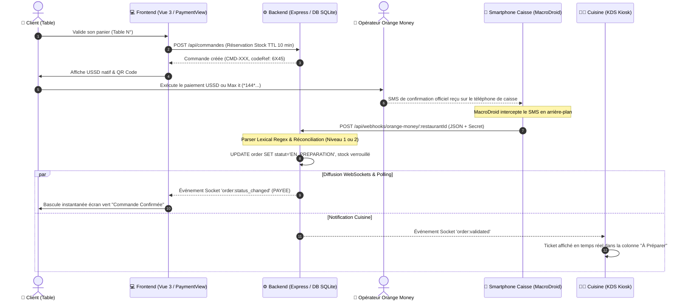
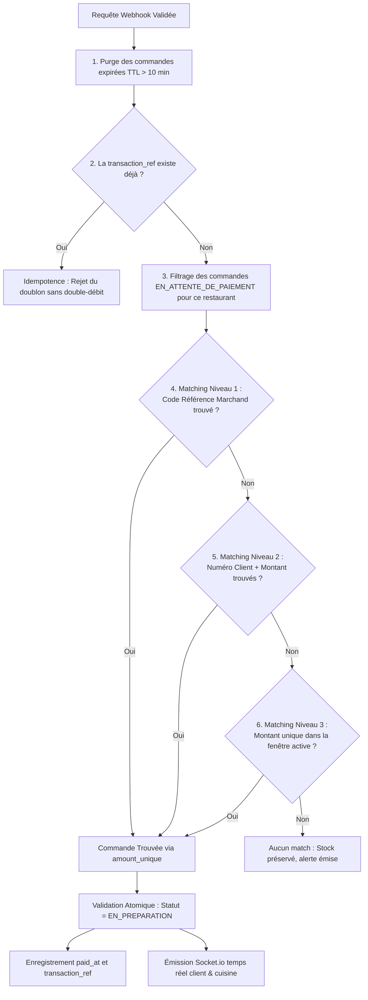

# ⚡ Système de Validation Automatique des Paiements (No-Aggregator)

> **Projet :** RestoPremium / SaasResto  
> **Module :** Réconciliation des paiements Mobile Money (Orange Money BF) via MacroDroid Bridge  
> **Statut :** Production & CI/CD validé (39/39 tests unitaires et d'intégration)

---

## 1. Vue d'Ensemble & Proposition de Valeur

Dans le secteur de la restauration en Afrique de l'Ouest, l'intégration des passerelles de paiement bancaires ou d'agrégateurs tiers classiques présente plusieurs freins majeurs :
1. **Commissions élevées :** Des prélèvements de 2% à 5% sur chaque transaction réduisent fortement la marge des restaurateurs.
2. **Délais de virement :** Les fonds sont bloqués sur des comptes séquestres 24h à 72h avant d'être reversés.
3. **Complexité contractuelle :** Nécessité de formalités administratives lourdes pour chaque établissement.

### L'approche "No-Aggregator" de RestoPremium
RestoPremium résout ce problème en établissant un **pont direct (bridge) sans intermédiaire** entre le paiement du client via son application/USSD Orange Money et le système de commande du restaurant :
* **Paiement direct :** L'argent va directement sur le compte Orange Money du restaurateur (Marchand ou Particulier/Caissier).
* **0% de commission tiers :** Seuls les frais opérateurs natifs s'appliquent.
* **Validation instantanée en < 2 secondes :** Un smartphone Android connecté en caisse écoute les notifications/SMS officiels de réception de fonds et notifie l'API de RestoPremium via un Webhook chiffré.
* **Notification temps réel :** Dès validation, le client voit son écran basculer sur la confirmation et le ticket s'imprime ou s'affiche immédiatement sur l'écran KDS de la cuisine.

---

## 2. Architecture Globale & Diagramme de Flux



---

## 3. Déclenchement Côté Client (Modes Marchand vs Classique)

Le système gère de manière transparente et multi-tenant deux types de comptes de restauration configurés dans la base de données :

| Critère | Compte Marchand Officiel | Compte Classique (Numéro Personnel / P2P) |
| :--- | :--- | :--- |
| **Profil restaurant** | Établissements avec numéro marchand agréé | Petits maquis, kiosques ou restaurants sans agrément |
| **Syntaxe USSD générée** | `*144*4*6*codeMarchand*montant*codeReference#` | `*144*2*1*numeroOM*montant#` |
| **Saisie requise du client** | Aucune saisie (code référence intégré dans l'USSD) | Obligation de renseigner son numéro de téléphone avant paiement |
| **Stratégie de matching** | Déterministe via le `codeReference` unique | Heuristique via le couple `(numeroClient + montant)` |

### Gestion des Navigateurs In-App (WebViews Réseaux Sociaux)
Lorsque le client scanne le QR Code de table depuis Facebook, TikTok, Instagram ou Snapchat, les navigateurs intégrés bloquent souvent le protocole `tel:`. Le composant [`PaymentView.vue`](file:///c:/Users/Dell/SAAS/SaasResto/src/views/client/PaymentView.vue) intègre :
1. **Solution Native (Navigateurs standards) :** Redirection automatique vers l'application téléphone native.
2. **Solution Android Deep-Link (Chrome Intent) :** `intent://...#Intent;scheme=https;package=com.android.chrome;end` pour sortir de la WebView.
3. **Solution Guide Visuel Assisté :** Copie en 1 clic de la syntaxe USSD avec bouton pour coller dans le clavier téléphonique.

---

## 4. Passerelle Mobile MacroDroid (Smartphone de Caisse)

Le téléphone de caisse (qui détient la puce SIM Orange Money ou l'application Max it) fait office de passerelle matérielle. L'application **MacroDroid** (gratuite sur le Play Store) y est installée.

### A. Déclencheur (Trigger)
* **Événement :** `Messages` ➔ `SMS Reçu`
* **Expéditeur :** Filtrer sur `OrangeMoney` ou `144` (ou tous les numéros en phase de test)
* **Contenu du message :** N'importe quel contenu (ou contenant `reçu` / `recu`)

### B. Action (Requête HTTP POST)
* **Méthode :** `POST`
* **URL de destination :**
  * *En production / Dev Tunnel :*  
    `https://seek-screening-unified-regulatory.trycloudflare.com/api/webhooks/orange-money`
  * *En réseau local direct (Wi-Fi de l'établissement) :*  
    `http://192.168.1.50:3000/api/webhooks/orange-money/resto-premium-01`
* **En-têtes HTTP (Headers) :**
  ```http
  Content-Type: application/json
  x-webhook-secret: resto_secret_2026
  ```
* **Corps de la requête (Body) :**
  ```json
  {
    "message": "[sms_body]",
    "sender": "[sms_number]"
  }
  ```
  *(Utilisez le sélecteur `[...]` dans MacroDroid pour insérer les balises de variables dynamiques).*

> [!IMPORTANT]
> **Configuration Dev Tunnels VS Code (si utilisé en développement local) :**
> Si vous exposez le port 3000 avec VS Code Dev Tunnels, faites un clic droit sur le port `3000` dans l'onglet **Ports** de VS Code et changez la visibilité de **Private** à **Public**. Faute de quoi, les requêtes du smartphone recevront un code d'erreur `401 Unauthorized` ou une redirection HTML.

---

## 5. Traitement Backend & Parser Lexical (`api/server.js`)

À la réception du webhook, le serveur applique une série de vérifications de sécurité et de normalisation textuelle :

### 1. Tolérance aux erreurs de syntaxe JSON Mobile
Les applications mobiles ou passerelles SMS omettent parfois d'échapper les sauts de ligne ou utilisent des guillemets simples. Un middleware sur-mesure capture l'erreur de parsing standard d'Express et reconstruit automatiquement un payload sain ou convertit le message brut.

### 2. Contrôle d'Accès Anti-Fraude
Le secret transmis dans l'en-tête `x-webhook-secret` (ou paramètre `?secret=`) est validé par rapport à la variable d'environnement `WEBHOOK_SECRET` (`resto_secret_2026`). Si absent ou erroné, la requête est immédiatement rejetée avec une erreur `401`.

### 3. Extraction Lexicale par Expressions Régulières (`parsePaymentNotification`)
Le message SMS brut est scanné pour en extraire les informations cardinales :
* **Montant :** Détection via regex des mentions `FCFA`, `F CFA`, `XOF` ou `F`.
* **Numéro Client :** Extraction des numéros de téléphone à 8 chiffres (commençant par 0, 5, 6, 7 avec ou sans indicatif `+226`).
* **Référence de Transaction :** Capture des libellés `Trans ID:`, `Réf Trans:`, `TxId:` pour le contrôle d'unicité.
* **Code Référence :** Détection des codes courts (ex: `ref 6X45`).

---

## 6. Moteur de Réconciliation en Base de Données (`api/db.js`)

La fonction `reconcilePaymentWebhook` applique une cascade d'arbitrage stricte :



### Règles de Réconciliation en Détail :
1. **Contrôle d'Idempotence :** Si un SMS est réémis (réseau mobile instable), le serveur vérifie la colonne `transaction_ref`. Si elle existe déjà, la commande n'est pas retraitée et une réponse neutre est renvoyée.
2. **Isolation Étanche Multi-Tenant :** Un webhook envoyé à `/api/webhooks/orange-money/le-braise-02` ne peut en aucun cas valider une commande passée sur `resto-premium-01`.
3. **Fenêtre de Verrouillage Stricte (TTL 10 min) :** Seules les commandes créées il y a moins de 10 minutes sont éligibles. Cela évite d'attribuer un paiement reçu par hasard à une vieille commande abandonnée la veille.

---

## 7. Règle Métier Caisse & Cuisine (KDS)

Pour garantir une exploitation fluide et zéro confusion en salle :
* **Invisibilité Caisse/Cuisine :** Une commande au statut `EN_ATTENTE_DE_PAIEMENT` **n'apparaît jamais** sur les écrans du personnel. Le personnel de caisse et de cuisine n'est pas perturbé par les abandons de panier ou les hésitations des clients.
* **Apparition Instantanée après Validation :** Dès que la réconciliation aboutit (statut `EN_PREPARATION`) :
  * L'écran caisse liste la commande comme encaissée.
  * L'écran cuisine KDS sonne et affiche le ticket avec les détails des plats et les notes de table.
  * Le client est basculé sur sa confirmation de commande.

---

## 8. Commandes de Test Manuel (cURL)

Vous pouvez simuler instantanément l'arrivée d'un paiement sans smartphone en exécutant ces commandes dans un terminal :

### Test 1 : Validation Marchand (Matching Niveau 1 par Code Référence)
```bash
curl -X POST http://localhost:3000/api/webhooks/orange-money/resto-premium-01 \
  -H "Content-Type: application/json" \
  -H "x-webhook-secret: resto_secret_2026" \
  -d '{"message": "Paiement marchand de 5000 FCFA recu de 70998877 ref 6X45 Trans ID: OM-MARCH-001."}'
```

### Test 2 : Validation Classique P2P (Matching Niveau 2 par Téléphone Client + Montant)
```bash
curl -X POST http://localhost:3000/api/webhooks/orange-money/resto-premium-01 \
  -H "Content-Type: application/json" \
  -H "x-webhook-secret: resto_secret_2026" \
  -d '{"message": "Vous avez recu 3500 FCFA de +226 70 12 34 56. Trans ID: CI240915.1010. Nouveau solde: 55000 FCFA."}'
```

### Test 3 : Vérification de la Sécurité (Tentative sans le Secret)
```bash
curl -X POST http://localhost:3000/api/webhooks/orange-money/resto-premium-01 \
  -H "Content-Type: application/json" \
  -d '{"message": "Vous avez recu 3500 FCFA"}'
# Réponse attendue : HTTP 401 Unauthorized
```

### Test 4 : Vérification de l'Idempotence (Rejouer le Test 2)
Rejouer la même commande renvoie :
```json
{
  "success": true,
  "duplicate": true,
  "matched": true,
  "message": "Transaction CI240915.1010 déjà enregistrée pour la commande CMD-..."
}
```

---

## 9. Matrice des Rôles & Sécurité Anti-Fraude

| Risque Identifié | Solution Technique Appliquée |
| :--- | :--- |
| **Faux webhook émis par un tiers** | Rejet systématique sans le header `x-webhook-secret`. |
| **Double encaissement / Rejeu SMS** | Contrôle d'unicité sur `transaction_ref` en base SQLite. |
| **Vol de commande par montant identique** | Désambiguïsation prioritaire par `code_reference` unique ou par numéro de téléphone payeur. |
| **Abandon de panier bloquant les stocks** | Cron d'expiration automatique toutes les 5s libérant les stocks après 10 minutes (TTL). |
| **Confusion entre établissements** | Isolation stricte par `restaurant_id` sur toutes les requêtes SQL. |
